

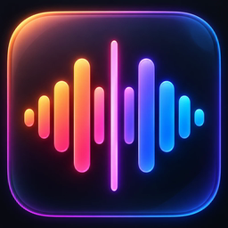

# Gonilift

**Take the singer out of any song, and sing it yourself.**

A free Windows app that splits any song into a **vocal track** and a **backing track** with AI, right on your own PC.
Mute the singer for karaoke, keep them softly underneath as a guide, move the song into your key, slow it down,
and loop the line you keep missing.

**No account. No subscription. No upload. No limits.**

**[Get the Easy Edition · $3.50](https://markbasa.itch.io/gonilift)** · ready to run: unzip, double-click, works offline from the first split

or **[⬇ download free (ZIP)](https://github.com/MarkBasa96/gonilift/archive/refs/heads/main.zip)** and set it up yourself · Windows 10 / 11 · Free and open source

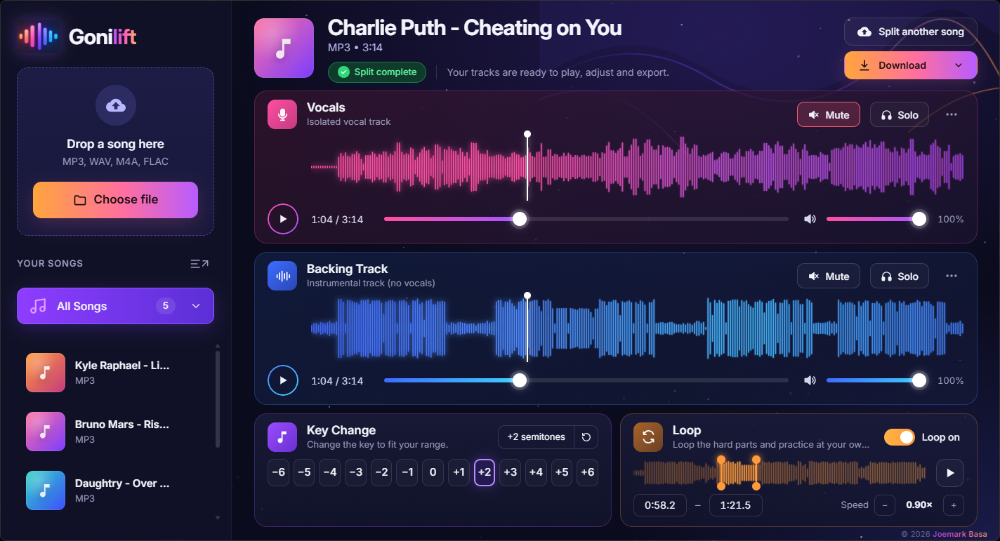

---

## Why it exists

Online vocal removers make you upload your music, wait in a queue, and pay once you pass a monthly limit.
Gonilift does the same job on your own computer. Drop a song in, and about a minute later you have the vocals and
the backing track as separate, studio-quality WAV files, plus a practice player built for singers.

### About the name

Gonilift is named after **Goning**, a friend of mine, plus *lift*: it lifts the voice out of a song so you can
sing it yourself.

## What it feels like

| The glass shine follows your mouse | Songs fade in, one by one |
|---|---|
|  | 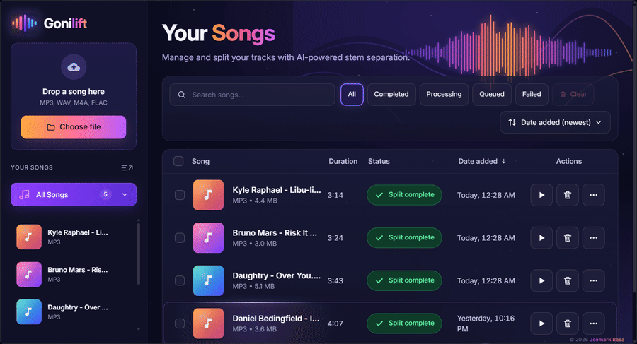 |

Every button gives a small bounce when you click it, pop-ups open on frosted glass, and long titles show in full
when you hover over them. It is a real app, too: its own window and taskbar icon, and it fills whatever screen you
put it on.

## Features

**Splitting**
- **Two clean tracks per song**, *Vocals* and *Backing Track*, from Kimberley Jensen's MelBand RoFormer AI model, one of the
  strongest open vocal-separation models available.
- **Fast on NVIDIA graphics cards:** about 40 seconds for a 3-minute song on an RTX 3050 laptop GPU. It also works
  without one, just slower.
- **Drop several songs at once.** They wait in a queue, show live progress, can be cancelled, and pick up where
  they stopped if you close the app mid-split.

**Practicing**
- **Mute, solo and volume** for each track, with both waveforms on screen.
- **Key change from −6 to +6 semitones** to fit your voice. Speed stays the same and voices keep their natural tone.
- **Speed from 0.5× to 1.25×** without changing the key.
- **Loop any part:** drag the two orange handles around the hard line and switch the loop on.
- **Keyboard:** Space plays and pauses, ← → jump 5 seconds, L turns the loop on and off.

**Your library**
- Search, filter by status, sort, and **tick several songs to clear them at once**.
- A three-dots menu on every song, and **confirm pop-ups before anything is deleted**.
- **Download the vocals, the backing, or both** as separate WAV files, in whatever key you picked. They go
  straight to your Downloads folder.

## Screenshots

| Start | Splitting |
|---|---|
| 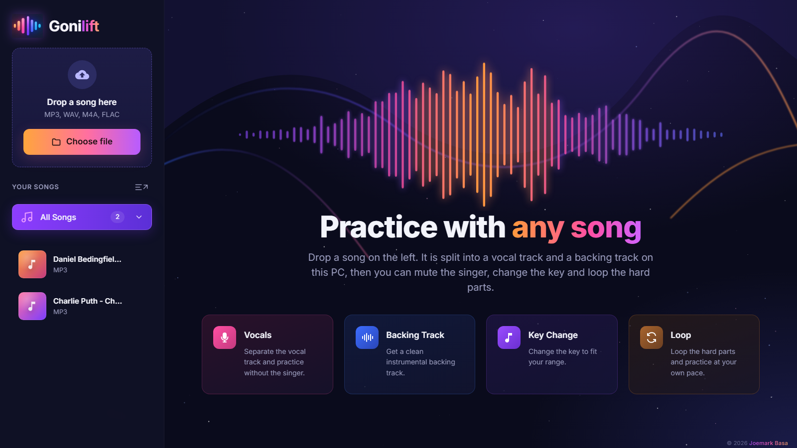 | 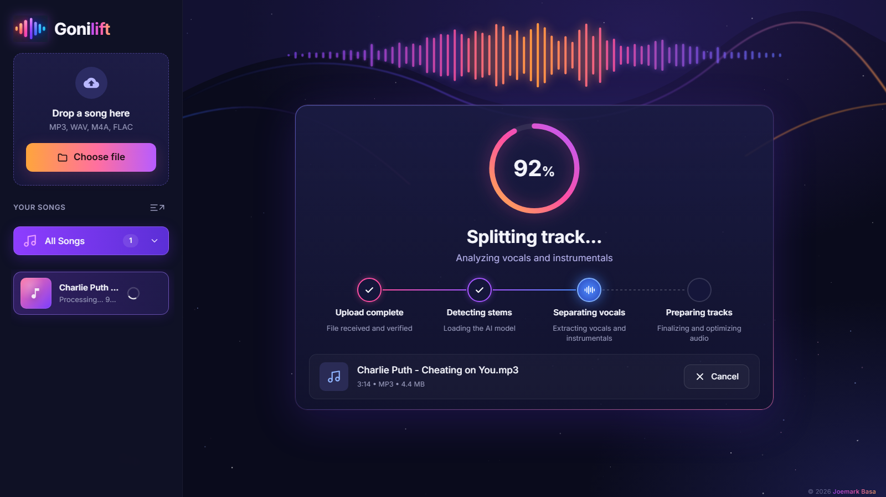 |

| Player | Download menu |
|---|---|
| 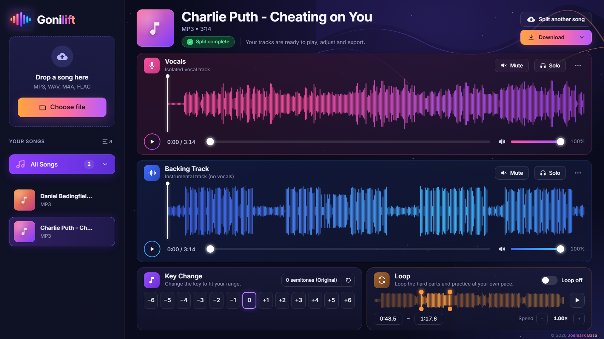 | 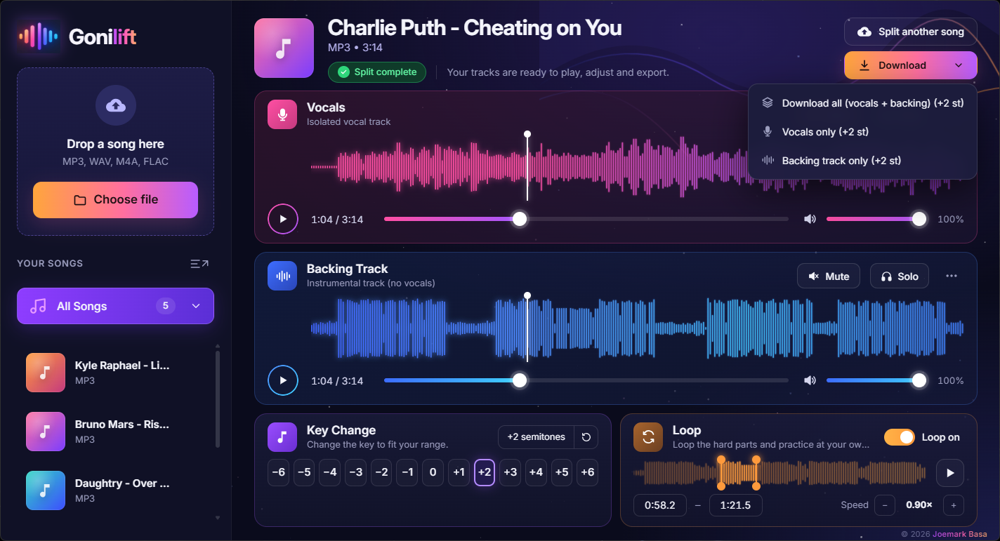 |

| Saved to Downloads | Your library |
|---|---|
| 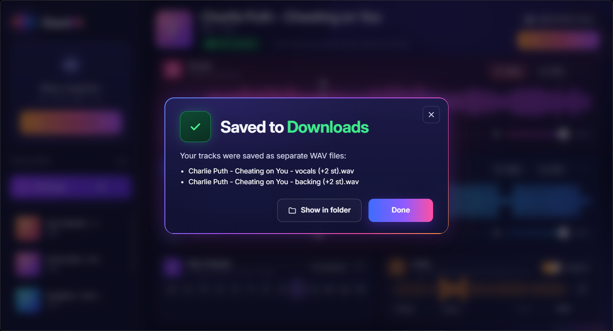 | 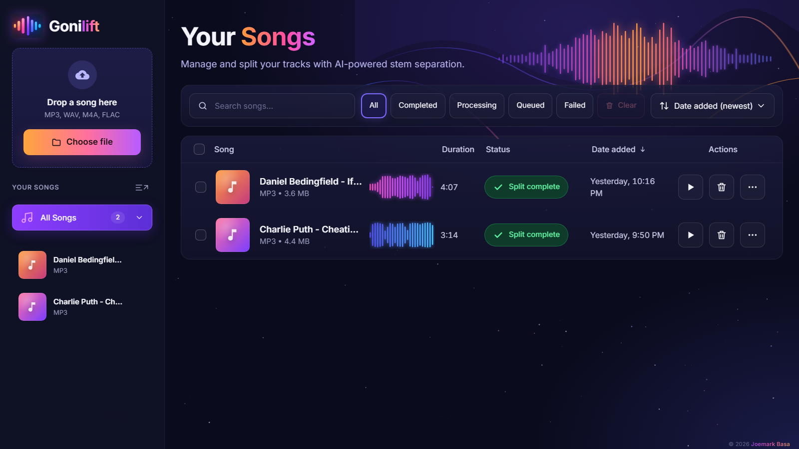 |

| Tick songs, then Clear | Confirm before deleting |
|---|---|
| 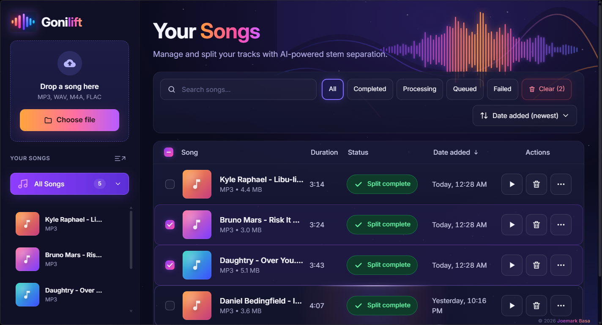 | 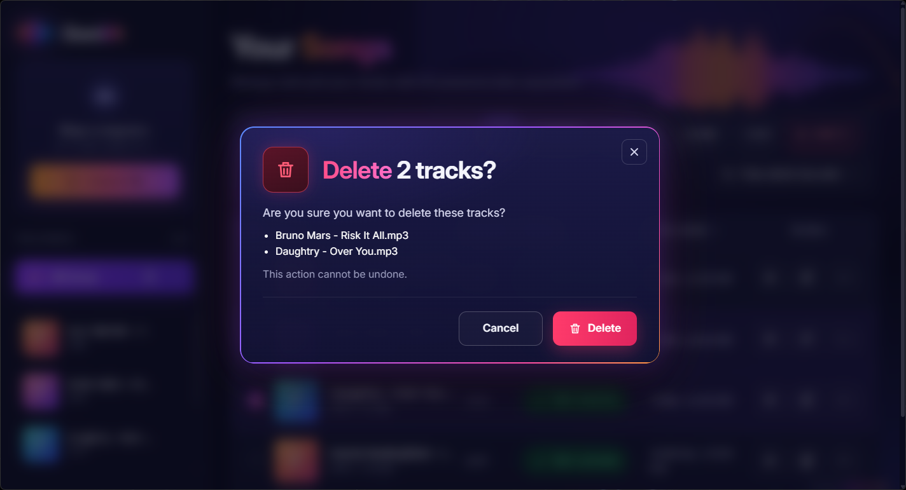 |

| Song menu in the sidebar | Full titles on hover |
|---|---|
| 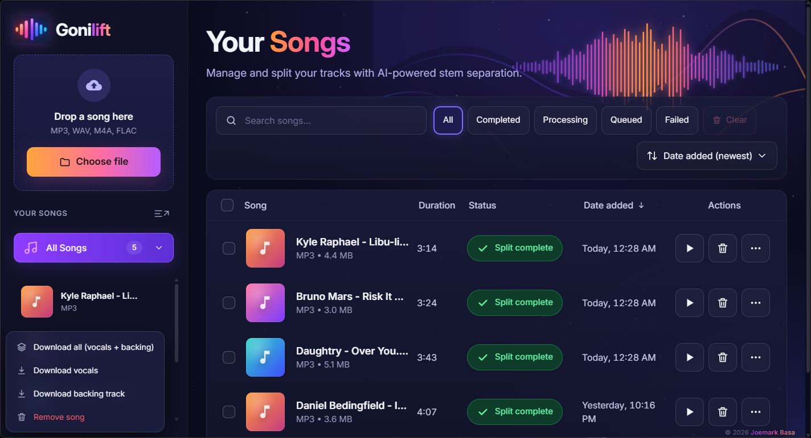 | 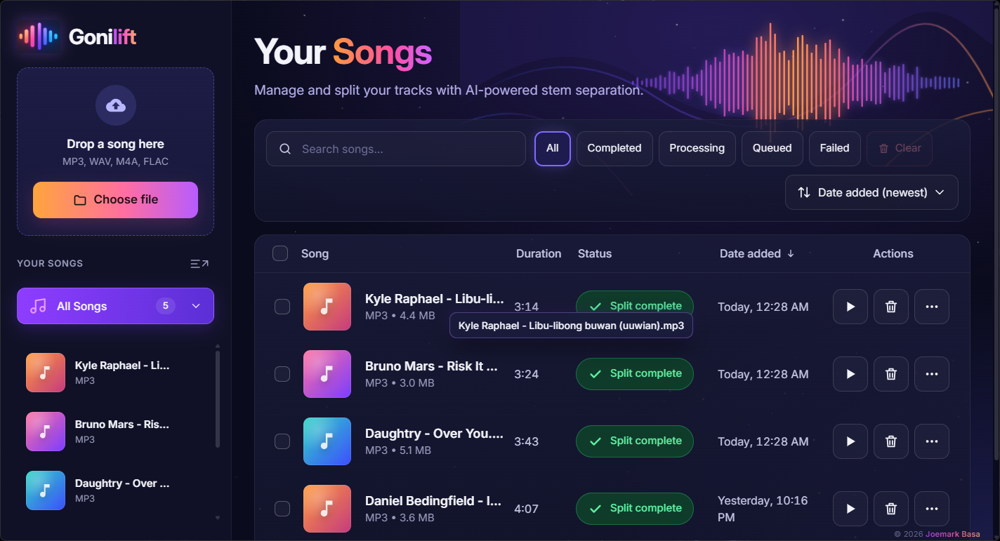 |

## Install

You need **Windows 10 or 11**, about **6 GB of free space**, and internet for the first setup.
(The [Easy Edition](https://markbasa.itch.io/gonilift) skips all of this: Python, the AI engine and the model are already inside.)

1. **[Download the ZIP](https://github.com/MarkBasa96/gonilift/archive/refs/heads/main.zip)** and unzip it somewhere
   outside OneDrive, for example `C:\Apps\Gonilift`.
2. Double-click **`install.bat`**. It sets everything up inside that folder in 5 to 15 minutes, mostly downloading
   PyTorch.
3. Open **Gonilift** from your Desktop or Start menu. The first split downloads the AI model (~900 MB) once.

<b>What install.bat does, step by step</b>

Everything is readable in [`tools/install.ps1`](tools/install.ps1), and it is safe to run again.

1. Installs **uv**, Astral's Python manager (through winget, or Astral's official script).
2. Installs **Python 3.11** and a private environment in `.venv`; it does not touch any other Python you have.
3. Installs **PyTorch**: the CUDA version if you have an NVIDIA card, the CPU version otherwise.
4. Installs Gonilift's packages from `requirements.txt` (exact, tested versions).
5. Uses your **ffmpeg** if it has the Rubber Band filter; otherwise downloads the latest stable build from
   [BtbN/FFmpeg-Builds](https://github.com/BtbN/FFmpeg-Builds) into `tools\ffmpeg` and checks its SHA-256.
6. Adds **Gonilift** to your Desktop and Start menu (your user only, no admin rights needed).

## FAQ

**Do I need a subscription, an account or an AI service?**
No. The AI is an open-source model that runs on your own computer, not an online service like ChatGPT. There is
nothing to pay, no sign-up and no API key, now or later.

**Does it work without internet?**
Yes, after the first setup. You need internet once to install it and once for the first split, which downloads the
AI model. After that it works fully offline. This was tested with all network access blocked: a 3-minute song split and changed key with zero attempts to reach the internet.

**Does anything keep running after I close it?**
No. Closing the window stops everything, including the background server. If you close it mid-split, that song
simply continues the next time you open Gonilift.

**Are my songs uploaded anywhere?**
No. Gonilift only listens on `127.0.0.1` (your own PC), the font is bundled, and nothing is sent anywhere.

**How fast is it?**

| Computer | 3-minute song |
|---|---|
| NVIDIA RTX 3050 laptop (6 GB) | about 40 seconds |
| No NVIDIA card (CPU only) | several minutes, depending on the processor |

Changing the key takes a few seconds the first time for each key, then it is instant.

**Can I use it in a browser instead?** Yes: `start.bat` opens the same app in your browser.

**Is it legal?** Gonilift is for personal practice with music you have the right to use. Splitting a song does not
give you any rights to it, so please don't publish tracks made from songs you don't own.

**How do I uninstall it?** Delete the Gonilift folder and its two shortcuts. The installer also adds uv and its
Python and cache (`%APPDATA%\uv`, `%LOCALAPPDATA%\uv`), which you can remove if nothing else uses uv.

**Something went wrong?** Gonilift writes `gonilift.log` in its folder. Please attach it when you
[open an issue](https://github.com/MarkBasa96/gonilift/issues).

## How it works

A small local server ([FastAPI](https://fastapi.tiangolo.com/)) does the work and one web page is the interface,
shown in its own window by [pywebview](https://pywebview.flowrl.com/) (Windows' built-in Edge WebView2).

- **Separation:** Kimberley Jensen's MelBand RoFormer vocal model (architecture: Wang, Lu & Won, 2023) through
  [python-audio-separator](https://github.com/nomadkaraoke/python-audio-separator) on
  [PyTorch](https://pytorch.org/). Tuned to 2 passes and half precision on NVIDIA cards: about 4× faster than the
  default settings, with a difference from full quality of −68 dB, far below hearing.
- **Key change:** ffmpeg with the [Rubber Band](https://breakfastquay.com/rubberband/) library, with formant
  preservation so voices don't sound like chipmunks. Each key is rendered once and kept.
- The model weights are downloaded from python-audio-separator's model repository the first time they are needed;
  they are not part of this repository.

## Credits

Built by **Joemark Basa**, and named for Goning. The vocal model is by **Kimberley Jensen** (MIT; see [THIRD-PARTY.md](THIRD-PARTY.md)). Thanks to the people behind python-audio-separator, the Mel-Band
RoFormer research and models, PyTorch, FFmpeg and BtbN's Windows builds, Rubber Band, FastAPI, pywebview and the
[Inter](https://rsms.me/inter/) typeface (SIL Open Font License).

## License

[MIT](LICENSE) © 2026 Joemark Basa
